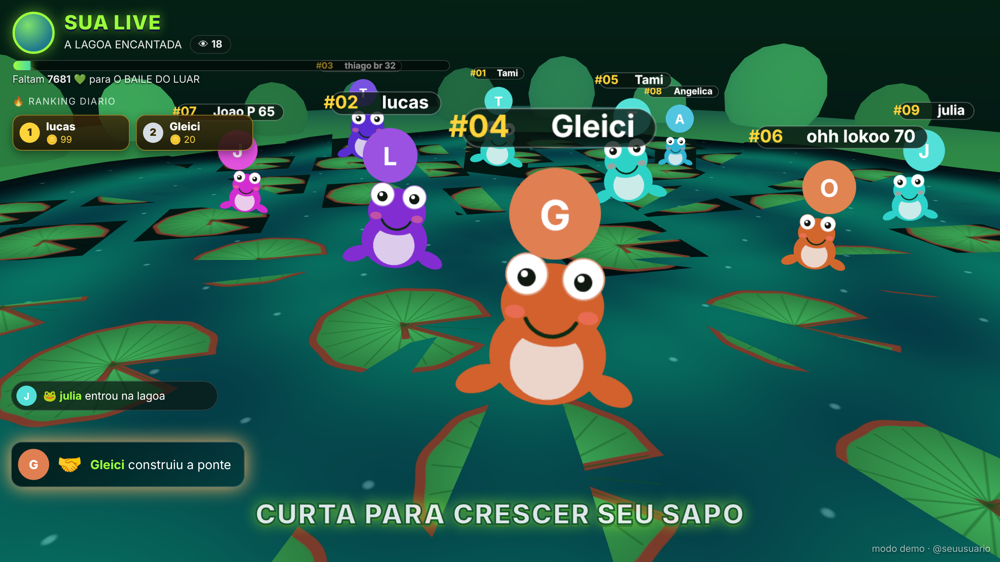

# 🐸 Festa na Lagoa — overlay de minigame pra live do TikTok

Overlay de lagoa 3D que roda como **Browser Source no OBS**. Cada espectador
vira um sapo numa vitória-régia com a foto e o nome dele; **like faz o sapo
crescer** até virar **PERERECA**; **presente** foca a câmera no doador com
efeito especial. Tem ranking, barra de meta, música e os sapos dançando.

Tudo com **arte própria** (os sapos, folhas e água são desenhados por código,
nada copiado) e **fácil de editar** no arquivo `overlay/config.js`.



---

## 1. O que você precisa

- **Node.js 18+** — baixe em https://nodejs.org (instala em 2 min).
- **OBS Studio** — https://obsproject.com
- Pronto. Não precisa de mais nada pra testar.

## 2. Rodar AGORA no modo demo (sem live, só pra ver funcionando)

Abra o terminal na pasta do projeto e rode:

```bash
npm install
npm run demo
```

Vai aparecer:

```
Overlay:   http://localhost:8080
```

Abra esse endereço no navegador. O modo demo gera entradas, likes e presentes
falsos sozinho — é só pra você ver a cara do jogo rolando. 🎉

## 3. Ligar na sua live de verdade

1. Abra `server/config.js` e troque `tiktokUsername` pelo **seu @** (sem o @):

   ```js
   tiktokUsername: 'seuusuario',
   ```

2. Rode em modo live:

   ```bash
   npm run live
   ```

   ou direto: `node server/index.js --live --user seuusuario`

3. **Importante:** a sua live tem que estar **no ar** na hora. O servidor
   conecta no WebSocket público da live e começa a receber os eventos
   (entrada, like, presente, comentário). Não existe API oficial da TikTok pra
   isso — a lib `tiktok-live-connector` faz essa ponte.

> Se a conexão com a live falhar muito (a TikTok às vezes exige assinatura de
> request), pegue uma chave grátis em https://www.eulerstream.com e cole em
> `signApiKey` no `server/config.js`.

## 4. Colocar no OBS

1. No OBS: **Fontes → + → Navegador (Browser Source)**.
2. Em **URL**, coloque: `http://localhost:8080`
3. **Largura 1920 / Altura 1080** (ou a resolução da sua live).
4. Marque **"Desligar a fonte quando não estiver visível" → desmarcado** e
   **"Atualizar navegador quando a cena ficar ativa"**.
5. OK. O overlay aparece como camada por cima do que você quiser.

Deixe o `npm run live` (ou `npm run demo`) **rodando no terminal** o tempo todo
enquanto estiver ao vivo — é ele que alimenta o overlay.

---

## 5. Deixar com a SUA cara (editar)

Mexa só no arquivo **`overlay/config.js`**. Lá dá pra trocar, sem programar:

| O quê | Onde |
|---|---|
| Nome da marca, nome do jogo, frase que pisca | `brand` |
| Título e recompensa da barra de meta + objetivo | `meta` |
| Título do ranking | `ranking` |
| Cores do tema (água, folha, neon, ouro…) | `cores` |
| Quantos likes pra virar sapo / perereca | `estagios` |
| Quantos sapos na tela ao mesmo tempo | `maxSapos` |
| **Presentes da sua live → efeito** (nome + emoji + tamanho) | `presentes` |
| Câmera girando, zoom no presente | `camera` |
| Música | `audio` |

### Combinar os presentes com a sua live
No `presentes`, a **chave** é o nome exato do presente como aparece no TikTok.
Configure os presentes que quiser na sua live e liste eles aqui com o efeito.
Nomes que não estiverem na lista usam o efeito `padrao`.

### Música
Por padrão toca uma **trilha ambiente gerada** (sem risco de copyright). Pra
usar a sua playlist, jogue os `.mp3` em `overlay/assets/musica/` e liste em
`audio.playlist`. Música com direitos autorais pode derrubar/mutar a live — a
trilha gerada evita isso.

### Logo e avatar do topo
Em `brand.logo` aponte pra uma imagem sua em `overlay/assets/` (ex:
`'assets/logo.png'`). Vazio = usa o desenho padrão.

---

## 6. Pra live não cair / não travar

- O overlay **reconecta sozinho** se o servidor cair, e o servidor **reconecta
  sozinho** na live se ela oscilar (até ela voltar).
- O Three.js é **local** (pasta `overlay/lib/`), não depende de internet nem de
  CDN — um site fora do ar não derruba o overlay.
- No OBS, o overlay é só uma camada: se precisar, dá **refresh** na Browser
  Source sem cortar a transmissão.
- Rode o terminal numa máquina estável; se usar internet móvel, tenha um plano
  B de conexão. (A estabilidade da *live em si* depende da sua conta e conexão,
  não do overlay.)

---

## Estrutura

```
festa-na-lagoa/
├── server/
│   ├── index.js      servidor: serve o overlay + repassa eventos da live
│   └── config.js     modo (demo/live), usuário, porta
└── overlay/
    ├── index.html
    ├── config.js     <<< A "NOSSA CARA": edite aqui
    ├── style.css
    ├── lib/three.module.js
    └── src/          cena 3D, sapos, câmera, HUD, áudio, eventos
```

Protótipo. Mecânica e código próprios; arte placeholder gerada por código.
